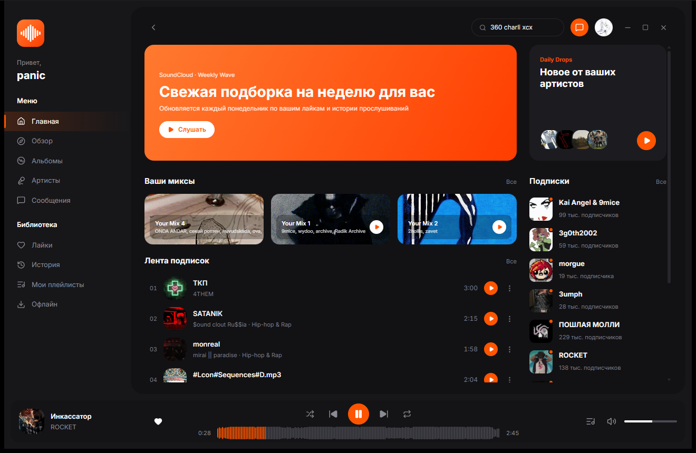
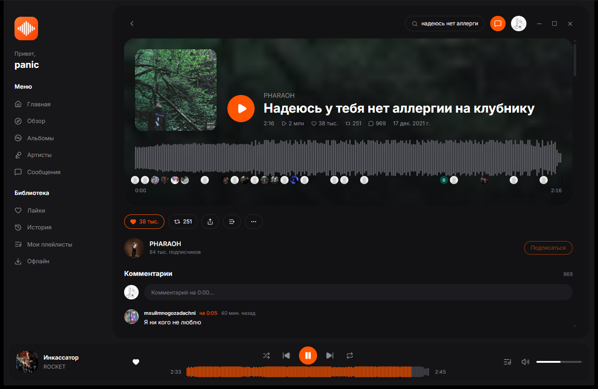
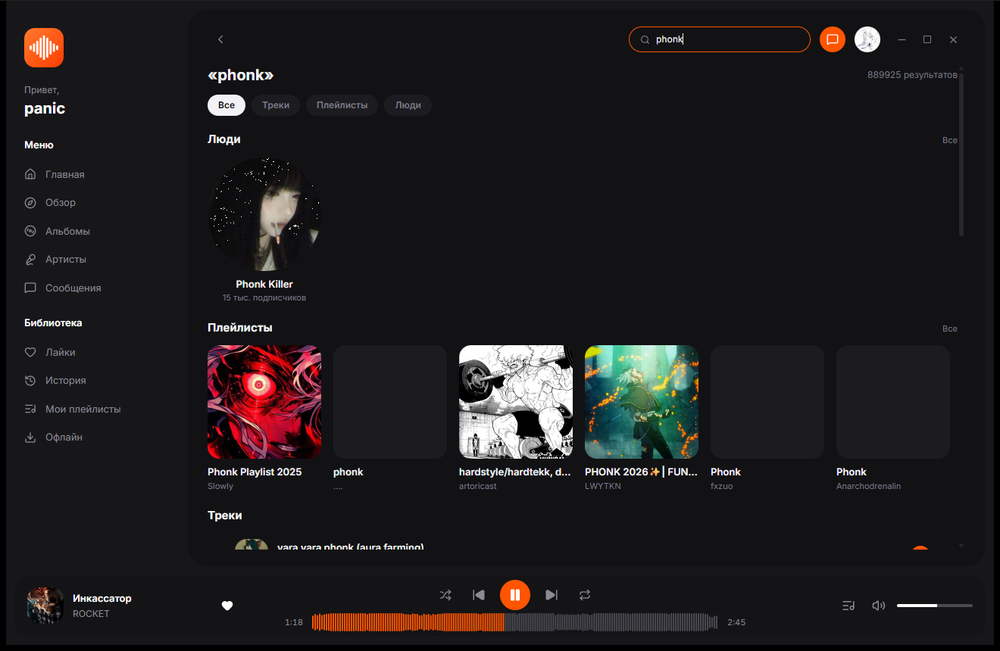
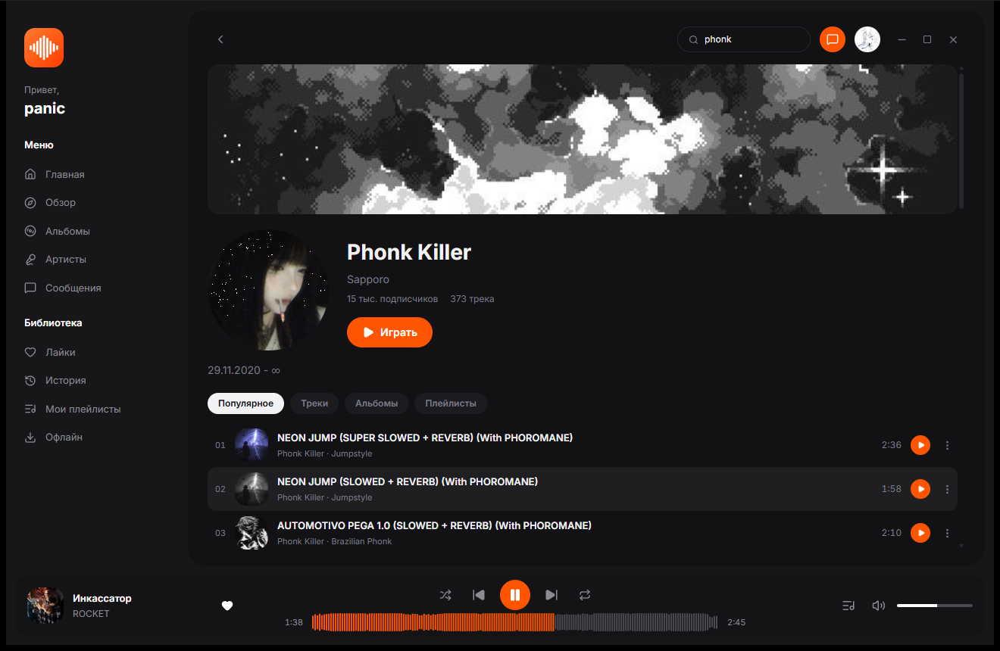

# Pulse

Fork of [zxcloli666/SoundCloud-Desktop](https://github.com/zxcloli666/SoundCloud-Desktop).

Личный десктоп-клиент SoundCloud для Windows 11. Ходит напрямую в SoundCloud (без промежуточных серверов), напрямую или через пользовательский SOCKS5/HTTP-прокси.

Стек: Tauri 2 (Rust) + React 19 + TypeScript + Vite + Tailwind 4.

## Интерфейс

| Главная | Страница трека |
| --- | --- |
|  |  |

| Поиск | Страница артиста |
| --- | --- |
|  |  |

## Возможности

- Вход через обычное окно SoundCloud, токен — в Windows Credential Manager.
- Плеер на стороне Rust: очередь, позиция, громкость, кэш и состояние переживают сворачивание в трей.
- Стрим по HLS; DRM-треки (Go+) играют через лицензированный Widevine в скрытом окне, без расшифровки на нашей стороне.
- Страница трека: волна с перемоткой и аватарами комментаторов, комментарии с тредами, лайки, репост, плейлисты.
- Главная, обзор, поиск, страницы артистов и плейлистов, библиотека, лайки, история.
- Светлая и тёмная темы, русский и английский языки по системному.

## Разработка

```bash
pnpm install
pnpm tauri dev
```

Проверки:

```bash
pnpm tsc --noEmit
pnpm biome check src/
cargo clippy --manifest-path src-tauri/Cargo.toml --all-targets -- -D warnings
cargo test --manifest-path src-tauri/Cargo.toml
```

План работ — [docs/FORK_PLAN.md](docs/FORK_PLAN.md), текущий статус — [docs/PROGRESS.md](docs/PROGRESS.md).

## Лицензия

MIT. Исходный код © zxcloli666, см. [LICENSE](LICENSE).
